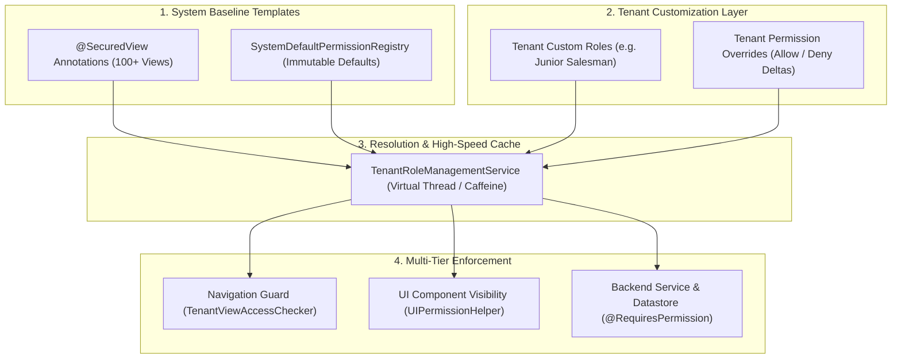

# Dynamic Multi-Tenant Role & View Authorization System

This guide explains how to implement, configure, and use the dynamic role-and-view authorization system in your multi-tenant Spring Boot + Vaadin Flow / Holon SaaS application.

---

## 1. Overview & Architecture

In large SaaS applications with 100+ views, tenant owners need the ability to control **which roles can access which views and actions** (e.g., allow `SALESMAN` to view and update customer details, but forbid customer creation or deletion), and dynamically change these permissions on the fly.



### Key Principles

1. **System Baseline Inheritance**: Out of the box, standard roles (`ADMIN`, `SALESMAN`, `ACCOUNTANT`, `OPERATOR`, `MEMBER`, `VIEWER`) have sensible default permissions defined in code.
2. **Delta Overrides (Zero DB Bloat)**: If a tenant uses default permissions, zero database records are created for that tenant. When an owner overrides an action or creates a custom role, only the delta is stored in `tenant_permission_overrides` or `tenant_custom_roles`.
3. **Seamless Platform Upgrades**: When view #101 is released in a platform update, existing tenants automatically inherit system baseline defaults for that new view without requiring database migration scripts.
4. **Defense-in-Depth**:
   - **Navigation Layer**: Blocks unauthorized route access.
   - **UI Component Layer**: Shows, hides, or disables buttons/tabs.
   - **Service Layer**: Protects mutations and business logic.
5. **One key format, one source of truth**: The Service Layer's `@RequiresPermission`
   annotation (Layer 4, `H`) enforces the *same* permission decision as the Navigation and UI
   Component layers whenever it's given a `"viewId:ACTION"` key — it delegates internally to
   the identical `TenantRoleManagementService` used by Layers `F`/`G`, instead of a separate
   store. See [Step 5](#step-5-protect-business-services-with-requirespermission) for the
   exact key format and the one case (flat, non-view-scoped permission keys) where a
   genuinely separate store is used on purpose.

---

## 2. Step-by-Step Implementation Guide

### Step 1: Annotate Views with `@SecuredView`

Add `@SecuredView` to each view class to declare its identifier, human-readable display name, functional category, and supported actions.

```java
package com.mycompany.crm.views;

import com.holonplatform.multitenant.permissions.view.ViewAction;
import com.holonplatform.multitenant.permissions.view.annotation.SecuredView;
import com.vaadin.flow.component.orderedlayout.VerticalLayout;
import com.vaadin.flow.router.Route;
import jakarta.annotation.security.PermitAll;

@Route(value = "customers", layout = MainLayout.class)
@PermitAll
@SecuredView(
    id = "customer-details",
    displayName = "Customer Details",
    category = "CRM",
    description = "View, manage, and update customer profiles",
    actions = {ViewAction.READ, ViewAction.CREATE, ViewAction.UPDATE, ViewAction.DELETE, ViewAction.EXPORT}
)
public class CustomerDetailsView extends VerticalLayout {
    // View implementation
}
```

---

### Step 2: Configure System Role Baseline Defaults (Optional Extension)

The platform provides default baseline mappings for standard roles in `DefaultSystemDefaultPermissionRegistry`. You can register additional custom defaults during startup if desired:

```java
@Configuration
public class SecurityBaselineConfig {

    @Autowired
    public void configureBaseline(SystemDefaultPermissionRegistry registry) {
        // Grant custom action on standard role
        registry.registerDefault(SystemRole.SALESMAN, "customer-details", 
                ViewAction.READ, ViewAction.UPDATE, ViewAction.EXPORT);
        
        // Wildcard access for Admin across all views
        registry.registerDefault(SystemRole.ADMIN, "*", "*");
    }
}
```

---

### Step 3: Secure Navigation with `TenantViewAccessChecker`

Wire `TenantViewAccessChecker` into your Vaadin `BeforeEnterListener` or custom navigation guard.

```java
package com.mycompany.crm.security;

import com.holonplatform.multitenant.permissions.view.TenantViewAccessChecker;
import com.vaadin.flow.router.BeforeEnterEvent;
import com.vaadin.flow.router.BeforeEnterListener;
import com.vaadin.flow.server.VaadinServiceInitListener;
import com.vaadin.flow.server.ServiceInitEvent;
import org.springframework.stereotype.Component;

@Component
public class SecurityNavigationGuard implements VaadinServiceInitListener, BeforeEnterListener {

    private final TenantViewAccessChecker accessChecker;

    public SecurityNavigationGuard(TenantViewAccessChecker accessChecker) {
        this.accessChecker = accessChecker;
    }

    @Override
    public void serviceInit(ServiceInitEvent event) {
        event.getSource().addUIInitListener(uiEvent -> {
            uiEvent.getUI().addBeforeEnterListener(this);
        });
    }

    @Override
    public void beforeEnter(BeforeEnterEvent event) {
        Class<?> target = event.getNavigationTarget();
        if (!accessChecker.checkAccess(target)) {
            // Reroute to 403 Access Denied page
            event.rerouteTo(AccessDeniedView.class);
        }
    }
}
```

---

### Step 4: Fine-Grained UI Component Binding with `UIPermissionHelper`

Use `UIPermissionHelper` inside your views to conditionally render buttons, menus, and forms based on the user's effective permissions.

```java
package com.mycompany.crm.views;

import com.holonplatform.multitenant.permissions.view.UIPermissionHelper;
import com.holonplatform.multitenant.permissions.view.ViewAction;
import com.holonplatform.multitenant.permissions.view.annotation.SecuredView;
import com.vaadin.flow.component.button.Button;
import com.vaadin.flow.component.orderedlayout.HorizontalLayout;
import com.vaadin.flow.component.orderedlayout.VerticalLayout;
import com.vaadin.flow.router.Route;
import jakarta.annotation.security.PermitAll;

@Route(value = "customers", layout = MainLayout.class)
@PermitAll
@SecuredView(
    id = "customer-details",
    displayName = "Customer Details",
    category = "CRM",
    actions = {ViewAction.READ, ViewAction.CREATE, ViewAction.UPDATE, ViewAction.DELETE, ViewAction.EXPORT}
)
public class CustomerDetailsView extends VerticalLayout {

    public CustomerDetailsView(UIPermissionHelper uiHelper) {
        Button createBtn = new Button("New Customer");
        Button editBtn = new Button("Edit");
        Button deleteBtn = new Button("Delete");
        Button exportBtn = new Button("Export CSV");

        // 1. Declarative component configuration
        createBtn.setVisible(uiHelper.isAllowed("customer-details", ViewAction.CREATE));
        editBtn.setVisible(uiHelper.isAllowed("customer-details", ViewAction.UPDATE));
        deleteBtn.setVisible(uiHelper.isAllowed("customer-details", ViewAction.DELETE));
        exportBtn.setVisible(uiHelper.isAllowed("customer-details", ViewAction.EXPORT));

        // 2. Functional callback execution
        createBtn.addClickListener(e -> {
            uiHelper.ifAllowed("customer-details", ViewAction.CREATE, () -> {
                openCustomerCreationDialog();
            });
        });

        add(new HorizontalLayout(createBtn, editBtn, deleteBtn, exportBtn));
    }

    private void openCustomerCreationDialog() {
        // Dialog logic
    }
}
```

---

### Step 5: Protect Business Services with `@RequiresPermission`

Protect your backend service methods to ensure actions cannot be invoked via API/RPC if bypassed on the client.

Use the **same `viewId:ACTION` key** as the view/action permission matrix from Steps 1–4 —
`@RequiresPermission` recognizes this `"viewId:ACTION"` shape and delegates to
`TenantRoleManagementService.currentUserCanPerformAction(viewId, action)` under the hood, so
the backend check enforces *exactly* the same decision the Tenant Owner Permission Matrix UI
(Section 3) manages. This is the recommended format for anything gating a `@SecuredView`'s
own actions:

```java
package com.mycompany.crm.service;

import com.holonplatform.multitenant.permissions.annotation.RequiresPermission;
import org.springframework.stereotype.Service;

@Service
public class CustomerService {

    @RequiresPermission("customer-details:CREATE")
    public void createCustomer(CustomerDto customer) {
        // Business logic
    }

    @RequiresPermission("customer-details:DELETE")
    public void deleteCustomer(Long customerId) {
        // Business logic
    }
}
```

`@RequiresPermission` also still supports **flat, opaque permission keys** (no colon) checked
against `TenantPermissionService`'s own role→permission store (`setPermissions`/`hasPermission`)
— use this independent, simpler system for permissions that aren't tied to a specific
`@SecuredView` (e.g. `"APPROVE_INVOICE"`, `"EXPORT_ALL_DATA"`):

```java
@RequiresPermission("APPROVE_INVOICE")
public void approveInvoice(Long id) { ... }
```

> **Only one of these two stores backs any given key.** A `"viewId:ACTION"` key (containing
> `:`) always resolves against the view/action matrix; a plain key never does. Don't mix the
> two for the same logical permission — pick `viewId:ACTION` when the permission mirrors a
> `@SecuredView` action (so it stays in sync with the UI layer automatically), and a flat key
> for anything else.

---

## 3. Real-Time Example: Tenant Owner Security Management UI

Here is a complete, real-world example of building a **Permission Matrix Management View** for Tenant Owners. It lets the owner view all registered views, toggle capabilities for any role, and reset overrides to system defaults.

```java
package com.mycompany.crm.views.admin;

import com.holonplatform.multitenant.TenantContext;
import com.holonplatform.multitenant.permissions.view.*;
import com.holonplatform.multitenant.permissions.view.annotation.SecuredView;
import com.vaadin.flow.component.button.Button;
import com.vaadin.flow.component.combobox.ComboBox;
import com.vaadin.flow.component.checkbox.Checkbox;
import com.vaadin.flow.component.grid.Grid;
import com.vaadin.flow.component.html.Span;
import com.vaadin.flow.component.notification.Notification;
import com.vaadin.flow.component.orderedlayout.HorizontalLayout;
import com.vaadin.flow.component.orderedlayout.VerticalLayout;
import com.vaadin.flow.router.Route;
import jakarta.annotation.security.RolesAllowed;

import java.util.List;

@Route(value = "admin/permissions", layout = MainLayout.class)
@RolesAllowed("ADMIN")
@SecuredView(id = "tenant-role-admin", displayName = "Role & Permission Matrix", category = "Settings")
public class TenantPermissionMatrixView extends VerticalLayout {

    private final TenantRoleManagementService roleService;
    private final ComboBox<RoleDefinition> roleSelector;
    private final Grid<RoleMatrixItem> matrixGrid;

    public TenantPermissionMatrixView(TenantRoleManagementService roleService) {
        this.roleService = roleService;
        String tenantId = TenantContext.require().tenantId();

        setSizeFull();

        // 1. Role Selection Header
        roleSelector = new ComboBox<>("Select Role");
        roleSelector.setItemLabelGenerator(r -> r.displayName() + (r.isSystemRole() ? " (Standard)" : " (Custom)"));
        roleSelector.setItems(roleService.getRoles(tenantId));

        Button resetRoleBtn = new Button("Reset Role to System Defaults", e -> {
            RoleDefinition selected = roleSelector.getValue();
            if (selected != null) {
                roleService.resetRoleToDefault(tenantId, selected.roleName());
                refreshMatrix();
                Notification.show("Reset " + selected.displayName() + " to system baseline defaults.");
            }
        });

        HorizontalLayout topBar = new HorizontalLayout(roleSelector, resetRoleBtn);
        topBar.setDefaultVerticalComponentAlignment(Alignment.BASELINE);

        // 2. Permission Matrix Grid
        matrixGrid = new Grid<>();
        matrixGrid.addColumn(RoleMatrixItem::category).setHeader("Module / Category").setAutoWidth(true);
        matrixGrid.addColumn(RoleMatrixItem::viewDisplayName).setHeader("View Name").setAutoWidth(true);
        matrixGrid.addColumn(RoleMatrixItem::action).setHeader("Action / Capability").setAutoWidth(true);

        // State indicator column
        matrixGrid.addComponentColumn(item -> {
            Span badge = new Span(item.customized() ? "Customized" : "System Default");
            badge.getElement().getThemeList().add(item.customized() ? "badge success primary" : "badge contrast");
            return badge;
        }).setHeader("Status");

        // Action toggle switch
        matrixGrid.addComponentColumn(item -> {
            Checkbox toggle = new Checkbox(item.allowed());
            toggle.addValueChangeListener(e -> {
                RoleDefinition currentRole = roleSelector.getValue();
                if (currentRole != null) {
                    roleService.setActionOverride(tenantId, currentRole.roleName(), item.viewId(), item.action(), e.getValue());
                    refreshMatrix();
                    Notification.show("Updated permission: " + item.viewDisplayName() + " [" + item.action() + "] -> " + (e.getValue() ? "ALLOWED" : "DENIED"));
                }
            });
            return toggle;
        }).setHeader("Allowed");

        // 1-Click Reset View Button
        matrixGrid.addComponentColumn(item -> {
            Button resetBtn = new Button("Reset View");
            resetBtn.setEnabled(item.customized());
            resetBtn.addClickListener(e -> {
                RoleDefinition currentRole = roleSelector.getValue();
                if (currentRole != null) {
                    roleService.resetViewToDefault(tenantId, currentRole.roleName(), item.viewId());
                    refreshMatrix();
                    Notification.show("Reset " + item.viewDisplayName() + " to default for " + currentRole.displayName());
                }
            });
            return resetBtn;
        }).setHeader("Action");

        roleSelector.addValueChangeListener(e -> refreshMatrix());

        add(topBar, matrixGrid);
    }

    private void refreshMatrix() {
        RoleDefinition role = roleSelector.getValue();
        if (role != null) {
            String tenantId = TenantContext.require().tenantId();
            List<RoleMatrixItem> matrix = roleService.getRoleMatrix(tenantId, role.roleName());
            matrixGrid.setItems(matrix);
        } else {
            matrixGrid.setItems(List.of());
        }
    }
}
```

---

## 4. How the Lifecycle Works in Production

1. **User Login & Context Resolution**:
   - The user authenticates (e.g. via Spring Security).
   - The user's tenant ID and job role (e.g., `SALESMAN`) are resolved.
2. **View Navigation**:
   - User clicks on `/customers`.
   - `TenantViewAccessChecker` checks `roleManagementService.currentUserCanAccessView("customer-details")`.
   - The service checks:
     1. Is there an active tenant override in `tenant_permission_overrides`? $\rightarrow$ If yes, return override value.
     2. Does the role inherit from a base template? $\rightarrow$ If yes, evaluate base template override/defaults.
     3. Fallback to `SystemDefaultPermissionRegistry` baseline for `SALESMAN`.
3. **UI Rendering**:
   - `UIPermissionHelper` checks `CREATE`, `UPDATE`, `DELETE`, `EXPORT` permissions.
   - Buttons for disallowed actions are hidden or disabled.
4. **Tenant Owner Changes Settings**:
   - Tenant owner opens `admin/permissions` and toggles `customer-details:CREATE` to `true` for `SALESMAN`.
   - `setActionOverride(...)` writes the delta record and automatically evicts the cache entry.
   - On the next page navigation or action by any `SALESMAN` in that tenant, the newly allowed action is immediately active.
